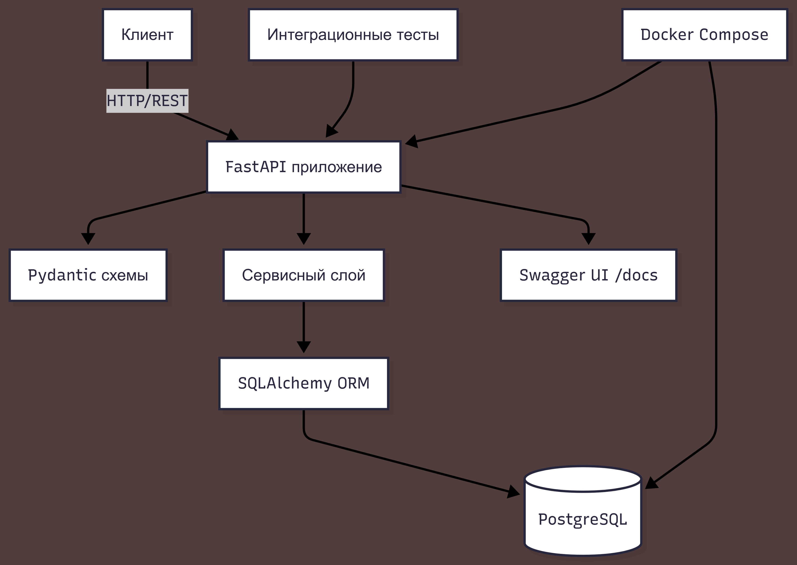

# API организационной структуры

REST API для управления организационной структурой компании: подразделения и сотрудники.

[](https://fastapi.tiangolo.com/)
[](https://www.postgresql.org/)
[](https://www.docker.com/)
[](https://pytest.org)
[](https://github.com/bsekinaev/org-structure-api/actions/workflows/tests.yml)

---

## ✨ Возможности
- CRUD для подразделений (создание, чтение, обновление, удаление)
- Хранение иерархии подразделений; API ограничивает глубину дерева параметром `depth` от 1 до 5
- Сотрудники привязаны к подразделениям
- Валидация уникальности имени в пределах родителя
- Защита от циклических ссылок при перемещении
- Каскадное удаление или перенос сотрудников
- Автоматическая документация Swagger UI
- Полная контейнеризация (Docker Compose)
- Интеграционные тесты (pytest)

---

## 🏗️ Архитектура



---
## Производительность и ограничения

В репозитории пока нет воспроизводимого бенчмарка (с фиксированным набором данных, конфигурацией окружения и результатами). Поэтому здесь **не заявляются** численные значения p95, времени выполнения операций или cache hit rate.

- Выдача дерева ограничена `depth=1..5` на уровне FastAPI.
- Проверка циклов проходит по цепочке родительских подразделений, а не за константное время.
- Redis-кэширование и JWT остаются в roadmap; в текущем составе зависимостей Redis отсутствует. GitHub Actions теперь выполняет интеграционные тесты.

Для подтверждения производительности следует добавить генератор тестовых данных, сценарии нагрузки и сохранённый отчёт с условиями измерений.

---

## 📡 API Endpoints

| Метод | Путь | Описание |
|-------|------|----------|
| `POST` | `/departments/` | Создать подразделение |
| `GET` | `/departments/{id}` | Получить дерево подразделения |
| `PATCH` | `/departments/{id}` | Обновить подразделение |
| `DELETE` | `/departments/{id}` | Удалить подразделение |
| `POST` | `/departments/{id}/employees/` | Добавить сотрудника |

---

## 🚀 Быстрый старт

### 1. Клонирование репозитория
```bash
git clone https://github.com/bsekinaev/org-structure-api.git
cd org-structure-api
```

### 2. Создайте `.env` из примера

```bash
cp .env.example .env
```

В Docker используется `DATABASE_URL=postgresql+psycopg2://postgres:postgres@db:5432/org_db`. Установленная зависимость — `psycopg2-binary` (синхронный драйвер). Старый URL с `postgresql://` автоматически нормализуется к `postgresql+psycopg2://` для совместимости. Не используйте примерные логин и пароль в публичном окружении.

При запуске API вне Docker вместо хоста `db` используйте `127.0.0.1` при доступном порте PostgreSQL.

### 3. Docker Compose и миграции

```bash
docker compose up -d db
docker compose build app
docker compose run --rm app python -m alembic upgrade head
docker compose up -d app
```

После запуска: `http://localhost:8000/`; Swagger UI: `http://localhost:8000/docs`. Все команды рассчитаны на локальный Docker Compose с тестовыми учётными данными, а не на удалённую базу.

---

## 🧪 Тесты

**Внимание:** интеграционные тесты удаляют содержимое таблиц `departments` и `employees` и сбрасывают последовательности. **Не запускайте их против основной или удалённой БД.** Тесты используют отдельный `TEST_DATABASE_URL` и fail-closed проверку: точное имя `org_db_test`, локальный/Compose host и явное разрешение `ALLOW_DESTRUCTIVE_TEST_DB=YES_DELETE_ORG_DB_TEST`. Разрешение допустимо **только для заведомо одноразовой БД**; проверка имени сама по себе не гарантирует её безопасность.

В локальном Docker Compose создайте **отдельную** тестовую БД (один раз, при отсутствии `org_db_test`):

```bash
docker compose exec db psql -U postgres -d postgres -c 'CREATE DATABASE org_db_test'
```

Примените к ней миграции и проверьте все тесты:

```bash
docker compose run --rm -e DATABASE_URL=postgresql+psycopg2://postgres:postgres@db:5432/org_db_test app python -m alembic upgrade head
docker compose run --rm \
  -e TEST_DATABASE_URL=postgresql+psycopg2://postgres:postgres@db:5432/org_db_test \
  -e ALLOW_DESTRUCTIVE_TEST_DB=YES_DELETE_ORG_DB_TEST \
  app python -m pytest tests/ -q
```

GitHub Actions проверяет **PostgreSQL 15 + Alembic + pytest**, а также отдельную **сборку через Docker Compose и тест самого упакованного образа (без bind mount `.:/app`)**: миграции, тесты, HTTP `/`, Swagger `/docs`, реальный `POST /departments/` → `GET /departments/{id}` и SQL `SELECT 1`. Базы и тома временные; workflow не выполняет production-деплой.

---

## 📁 Структура проекта
```
org-structure-api/
├── app/
│   ├── main.py          # FastAPI приложение
│   ├── models.py        # SQLAlchemy модели
│   ├── schemas.py       # Pydantic схемы
│   ├── services.py      # Бизнес-логика
│   └── database.py      # Подключение к БД
├── tests/
│   └── test_api.py      # Интеграционные тесты
├── alembic/             # Миграции
├── docker-compose.yml
├── Dockerfile
├── requirements.txt
└── README.md
```

---

## 🚧 Дальнейшее развитие

- [x] CRUD для подразделений и сотрудников
- [x] Древовидная структура с проверкой циклов
- [x] Каскадное удаление и перенос сотрудников
- [x] Интеграционные тесты (pytest)
- [x] Docker Compose и автодокументация
- [ ] Кэширование часто запрашиваемых деревьев (Redis)
- [ ] Пагинация для списков сотрудников
- [ ] Авторизация и разделение ролей (JWT)
- [x] GitHub Actions CI: PostgreSQL 15, Alembic, pytest (без автоматического деплоя)
- [ ] Экспорт структуры в CSV/JSON
- [ ] Логирование и мониторинг
- [ ] Фронтенд для визуализации дерева

---

## 👤 Автор
**Батраз Секинаев**  
Python Backend Developer  
📧 bsekinaev@ya.ru | 📢 [@bsekinaev](https://t.me/bsekinaev) | ⭐️ [GitHub](https://github.com/bsekinaev)


